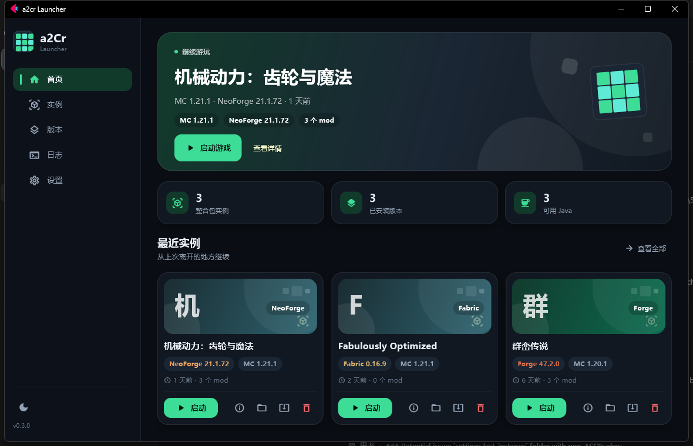
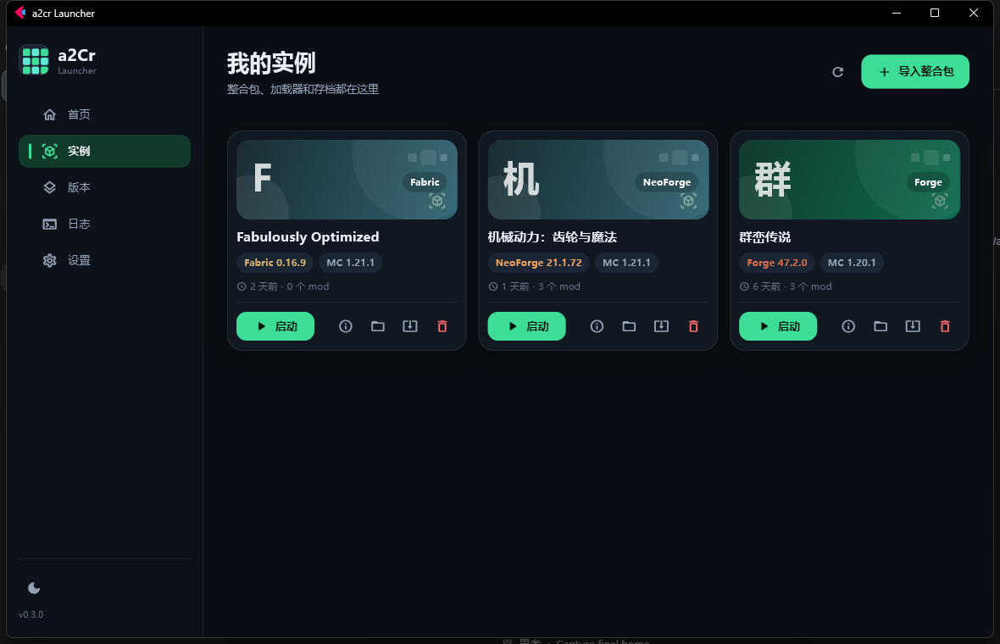
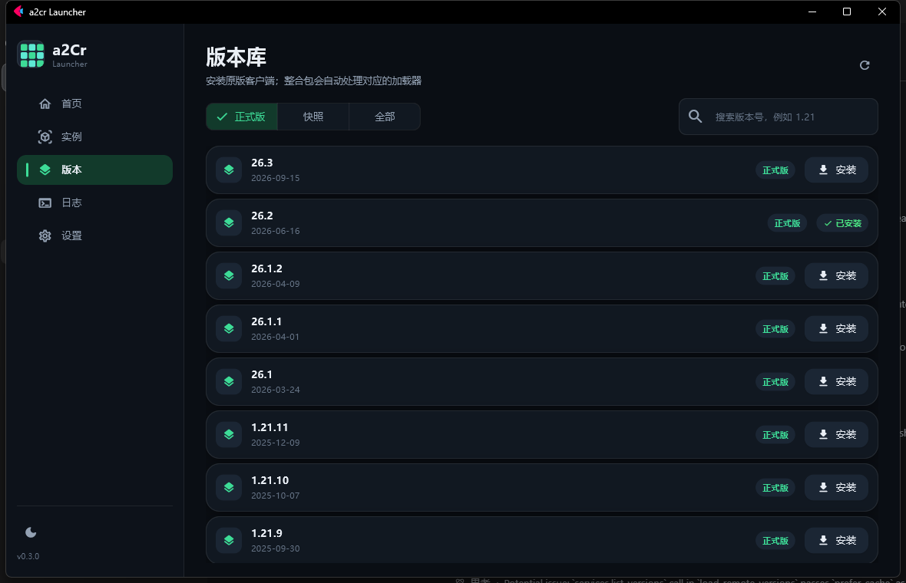
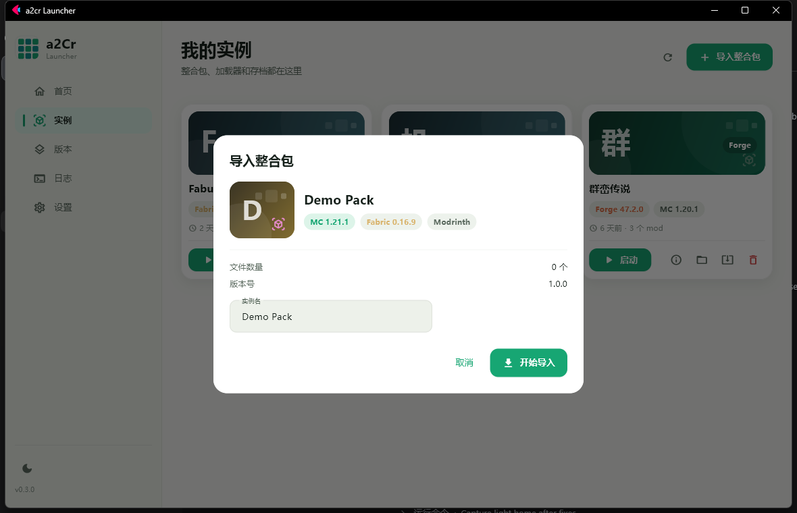
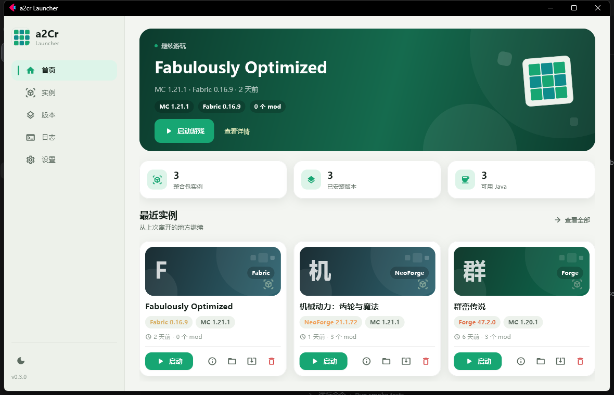

# a2Cr Launcher

一个使用 Python 制作的 Minecraft 启动器（CLI + 图形界面）



## 界面预览

| 实例 | 版本 |
|---|---|
|  |  |

| 导入 | 浅色主题 |
|---|---|
|  |  |


## 如何开发

### Step 1 克隆源代码和准备开发环境

1. 首先，这个程序是基于 Python
   开发的，因此，这里推荐的开发环境是 [JetBrains PyCharm](https://www.jetbrains.com/pycharm/download/)  
   _[Visual Studio Code](https://code.visualstudio.com) 也是可以的_

2. 其次，是 Python 环境，这里推荐使用 `uv`， 一个极其轻量的 Python 虚拟环境和包管理器。  
   把这段脚本复制到 PowerShell 里即可（桌面右键 --> 终端）

    ```bash
    powershell -ExecutionPolicy ByPass -c "irm https://astral.sh/uv/install.ps1 | iex"
    ```

3. 再之后，安装 [Git](https://git-scm.com/install/windows) ，这个是用来克隆源代码的工具  
   如果还没有安装的话，点上面链接下载安装包，安装一路下一步就可以

4. 接下来，是仓库的配置  
   如果需要对这个项目开发的话，需要 [Fork 代码](https://github.com/CILXRY/a2cr-Launcher/fork)
   ，也就是给代码仓库创建一个副本。  
   在创建一个 Fork 之后的项目，点击右上角的绿色的 `code`， 复制地址
5. 然后，在文件管理器里找一个存放代码的位置，打开终端

   ```bash
   git clone <刚刚复制的地址> # 比如， git clone https://github.com/CILXRY/a2cr-Launcher
   
   # Git 的配置
   git config --global user.name "你的名字"
   git config --global user.email "你的邮箱" # 设置和 GitHub 相同的邮箱
   ```
6. 最后，在 PyCharm 里打开这个存放代码的文件夹，在终端里运行 `uv run al` 即可。

## 使用

### 图形界面

```bash
uv run al-gui
```

图形界面提供：

- 首页继续游玩、实例卡片和运行状态
- 导入 / 更新 Modrinth、CurseForge、HMCL / PCL 整合包
- 启动、停止游戏，实时查看整合包和游戏日志
- 浏览 Mojang 版本列表并安装原版
- 设置玩家名、最大内存、Java 运行时和主题
- 删除实例时先移入启动器回收站（`~/.a2CrLauncher/.trash`）

如果在开发时需要把启动器数据放到别的目录（例如做界面截图、避免动真实实例）：

```powershell
$env:A2CR_ROOT = "$PWD\artifacts\demo-root"
uv run al-gui
```

### 命令行

```bash
uv run al version                         # 查看可用版本
uv run al install --version 26.2          # 安装原版
uv run al launch --version 26.2           # 启动原版
```

### 导入整合包

支持三种整合包格式：

- **Modrinth** `.mrpack`
- **CurseForge** 整合包 `.zip`（压缩包里有 `manifest.json`）
- **HMCL / PCL** 导出的整合包（压缩包里有 `.minecraft` 目录）

```bash
uv run al import "Fabulously Optimized.mrpack"
uv run al import "Create 整合包.zip" --name "机械动力"
```

导入时会自动完成：

1. 识别 Minecraft 版本和加载器（Fabric / Quilt / Forge / NeoForge）
2. 下载原版客户端、资源文件和运行库
3. 安装对应加载器（Forge / NeoForge 会调用官方安装器，第一次会慢一些）
4. 解压 `overrides` 或整合包自带的文件到 `~/.a2CrLauncher/instances/<实例名>/`
5. 下载清单里的 mods

导入完成后启动：

```bash
uv run al launch --instance "机械动力"
uv run al launch --instance "机械动力" --memory 8G   # 大型整合包可以调大内存
```

查看已经导入的整合包：

```bash
uv run al instance list
```
